  
  
  
  

I've spent the last few years at ZURU Tech building frontends for a real-time messaging app, an account and sign-in system, and a GIS tool for building-code compliance. Most days that means React, TypeScript, WebSockets and a lot of time in the profiler. In the evenings I build developer tools on top of LLMs.

<a href="https://endpoint-ai.vercel.app">Try Endpoint live</a> &nbsp;|&nbsp; <a href="https://github.com/Digvijay-Chavda/endpoint-ai">Read the source</a>

Open to frontend and AI engineering roles. The full story is on my <a href="https://digvijay-chavda.vercel.app/">portfolio</a>.

