  
  
  
  

I've spent the last few years at ZURU Tech building frontends for a real-time messaging app, an account and sign-in system, and a GIS tool for building-code compliance. Most days that means React, TypeScript, WebSockets and a lot of time in the profiler. In the evenings I build developer tools on top of LLMs.

**Stack**  `[prod]` shipped at work &nbsp; `[side]` side projects &nbsp; `[lrng]` learning

Open to frontend and AI engineering roles. More on my <a href="https://digvijay-chavda.vercel.app/">portfolio</a>.

