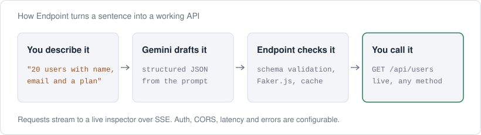

<picture>
  <source media="(prefers-color-scheme: dark)" srcset="assets/hero-dark.svg">
  
</picture>

I build frontends for a living and AI developer tools on the side. At ZURU Tech I've spent the last few years on a real-time messaging app, an account and sign-in system, and a GIS tool for building-code compliance. That's mostly React, TypeScript, WebSockets and a lot of time in the profiler.

Find me on [LinkedIn](https://www.linkedin.com/in/digvijaychavda) or at [digvijay.chavda.dev@gmail.com](mailto:digvijay.chavda.dev@gmail.com).

## Endpoint

<picture>
  <source media="(prefers-color-scheme: dark)" srcset="assets/endpoint-dark.svg">
  
</picture>

A mock API platform for frontend developers who are blocked on a backend that doesn't exist yet. You write one sentence and get a real endpoint you can fetch from your app.

[Try it live](https://endpoint-ai.vercel.app) or [read the code](https://github.com/Digvijay-Chavda/endpoint-ai). Built with Next.js, TypeScript, PostgreSQL, Prisma and the Gemini API.

## Building next

**Endpoint MCP server.** Lets Claude and other agents create and inspect mock APIs directly, so an agent writing frontend code can also stand up the API it needs.

**MockPilot.** An interview practice tool where one model plays the interviewer and a second one grades the answers against a fixed rubric, so the feedback stays consistent.

## How I work

| Every day | Comfortable with | Learning now |
|---|---|---|
| React, TypeScript, Next.js | Tailwind, shadcn/ui, Redux Toolkit | Model Context Protocol |
| Zustand, TanStack Query | PostgreSQL, Prisma, REST | LangGraph |
| WebSockets, real-time UI | Jest, Vitest, GitLab CI/CD | Python |
| Performance and TS migrations | Gemini API, Claude Code | Agent evaluation |
